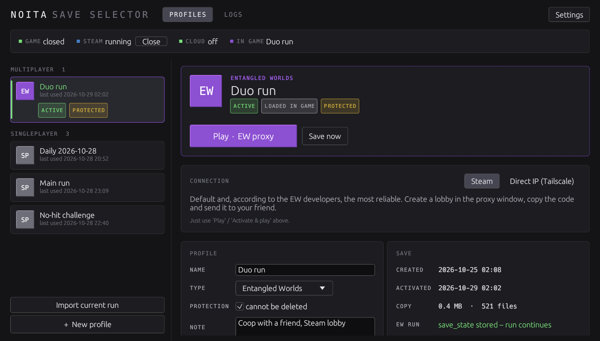
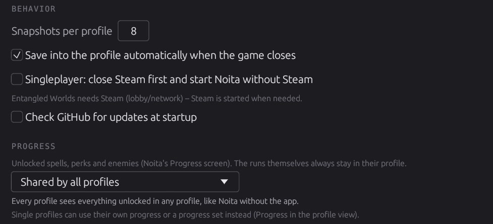
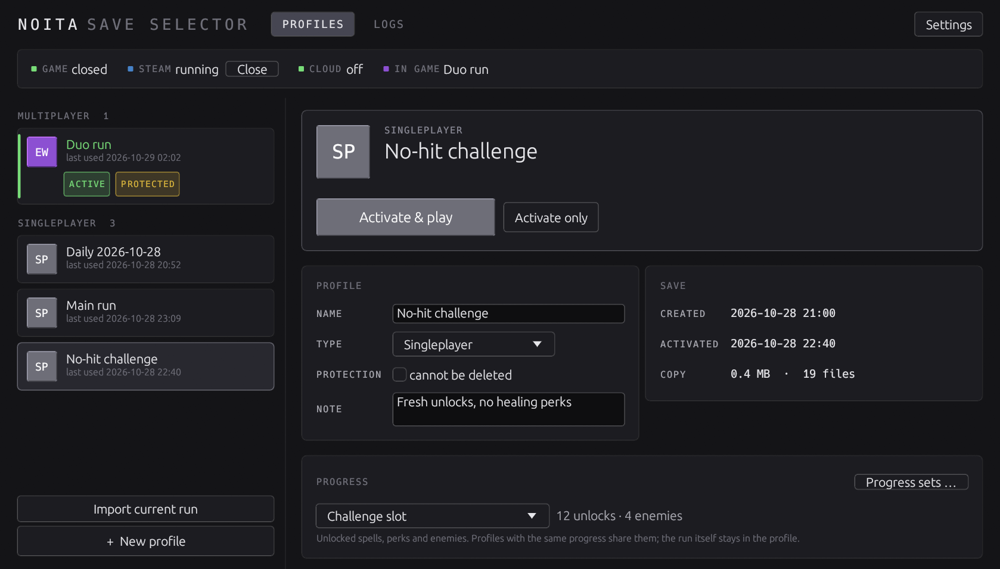
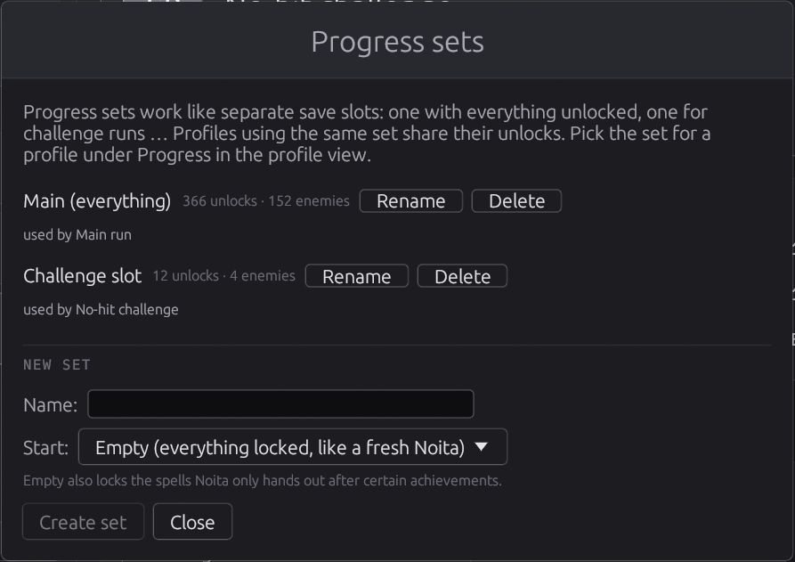

# Noita Save Selector

Profiles for Noita saves: Singleplayer, **Noita Together** and **Entangled Worlds** side by side, without the runs overwriting each other. One click swaps the save and starts the right program.

Windows, a single exe, no admin rights needed.



## Install
1. Download the latest `NoitaSaveSelector-Setup-x.y.z.exe` from [Releases](https://github.com/Rayyrawr/NoitaSaveSelector/releases) and run it.
2. Pick a data folder (default `%LOCALAPPDATA%\NoitaSaveSelector`). Profiles, snapshots and logs live there.
3. The installer looks for **Steam**, **Noita**, **Noita Together** and the **Entangled Worlds proxy** (`noita_proxy.exe`) on its own and shows what it found at the end.

If something is missing, enter the path in the app under *Settings* or click *Find paths automatically*.

**Portable:** Instead of the installer you can put `NoitaSaveSelector.exe` in its own folder with an empty `portable.txt` next to it. Everything then stays in that folder.

## Updates (patcher)
At startup the app asks GitHub for a newer version (can be turned off). If there is one, **Update x.y.z** appears at the top.
*Update now* downloads the new exe, checks its SHA-256 checksum, swaps it in and restarts. Profiles and settings stay as they are.
Manually: *Settings > Check for updates*. Installing a newer installer over the old version works too.

## Uninstall
*Settings > Uninstall* (or Windows "Apps & features"). The save that is loaded in Noita right now stays there, so you can keep playing it without the app. By default the data folder is kept; tick *Also delete the stored profiles, snapshots and logs* to remove it too (the dialog lists which profiles would be lost).

## First start
The app notices that the current save does not belong to a profile yet and offers to import it.
The type (Entangled Worlds / Noita Together / Singleplayer) is detected from the enabled mods. The save itself is not changed.

## Usage
- **Pick a profile** → *Activate & play*.
  - Singleplayer: starts `noita.exe`
  - Entangled Worlds: starts the EW proxy (and Steam if needed), which then starts Noita
  - Noita Together: starts the Noita Together app + Noita
- **Switching only works while Noita, the EW proxy and Noita Together are closed.**
- When the game closes, the app saves into the active profile automatically (can be turned off).
- *Import current run* stores whatever run is in Noita right now as its own profile, e.g. a daily or a new game you started directly in Noita. The profile that was active keeps its own run.
- The app knows which run a save holds (Noita's run start time in `world_state.xml`). If Noita holds a different run than the active profile, nothing is saved automatically; a banner offers to import it as a new profile or to overwrite the profile on purpose.
- *+ New profile* starts a fresh run. The mod list is carried over (multiplayer mods are switched on/off to match the type) and you pick which progress it uses.

## What gets swapped?
| | Location |
|---|---|
| Noita save (+ mod list) | `%USERPROFILE%\AppData\LocalLow\Nolla_Games_Noita\save00` |
| Entangled Worlds run (EW profiles only) | `%APPDATA%\quant\entangledworlds\data\save_state` |

`save_shared` and the EW settings are left alone.

## Progress
Noita's Progress screen (unlocked spells and perks in `save00\persistent`, enemies in `save00\stats`) can be shared between profiles. Settings → Progress:



- **Shared by all profiles** (default): like Noita without the app – whatever you unlock in one profile shows up in all of them.
- **Singleplayer and multiplayer separate**: singleplayer profiles share one progress, Noita Together and Entangled Worlds profiles another.
- **Per profile**: each profile keeps the progress it was played with.

The run itself (world, player, inventory) always stays in its profile. Shared progress lives in `progress\` in the data folder; saving a profile adds its progress there, activating a profile adds it from there. Nothing is ever taken away: unknown unlocks are copied, enemy counters take the higher value. Unlocks also decide which spells and perks can appear in parts of the world that are generated later, so a run continued with newer progress can find spells it couldn't before.
When the mode changes, the existing profiles are merged once (with the game closed); each profile's previous progress is kept in `backups\_progress\`.

### Progress sets


Like separate save slots: one set with everything unlocked, one for challenge runs that starts with nothing unlocked, and so on. Profile view → Progress → **Progress sets …** creates, renames and deletes them (a new set starts empty or as a copy of an existing progress). In the same place each profile picks what it uses: the default from the settings, a set, or its own progress. Profiles using the same set share their unlocks; activating a profile gives it exactly the set's progress, saving it adds what was unlocked. Changing a profile's progress backs up its previous progress in `backups\_progress\`.



## Safety
- The live folder carries a marker `.nss_profile`. Data is written back into a profile **only** when it matches. If the folder was replaced from outside (e.g. by Steam Cloud), the app refuses to save.
- Before every save the previous profile copy is kept as a snapshot in `backups\<profile-id>\` (count configurable, default 8).
- `backups\_last_live`: the live save right before the last switch. `backups\_unassigned`: data that belonged to no profile (never deleted). `backups\_deleted`: deleted profiles.
- Only one instance of the app runs at a time.
- Uninstalling does **not** delete profiles or backups.
- **Turn off Steam Cloud for Noita** (the app shows its state at the top): Steam → Noita → Properties → General → "Keep game saves in the Steam Cloud".

## Logs & network (Entangled Worlds)
- After every session the app copies `ew_log.txt` (EW proxy) and `logger.txt` (Noita) to `logs\<profile-id>\`.
- **Logs** tab: sessions per profile, summary (duration, players, incidents, kicks) and the log lines.
- While the proxy runs, the status bar shows **Network: stable / shaky / dropped**.

## Direct IP (e.g. Tailscale)
In an EW profile switch *Connection* to **Direct IP (Tailscale)**: *Host via IP* (`--host <port>`) or *Join* with `IP:port`. Afterwards click **Stop proxy** at the top (in IP mode the proxy has no window).

## Building
Requirements: Rust (MSVC), [Inno Setup 6](https://jrsoftware.org/isinfo.php) for the installer.

```powershell
cd app; cargo test; cd ..
.\installer\build.ps1      # -> dist\NoitaSaveSelector-Setup-<version>.exe, dist\NoitaSaveSelector.exe(.sha256)
```

The icon is pixel art in `app\assets\icon.txt` (palette + 16x16 grid). The build turns it into the exe/installer `.ico`, and the app uses it as the window icon.

**Release:** bump the version in `app\Cargo.toml`, add a section to `CHANGELOG.md`, push a tag `vX.Y.Z`. GitHub Actions tests, builds and publishes installer + exe + checksum; the in-app patcher then finds it automatically.

Testing against a copy of real data: point `NSS_ROOT`, `NSS_LIVE_SAVE`, `NSS_EW_STATE` at sandbox folders (see `saves.rs`).

## License
MIT
